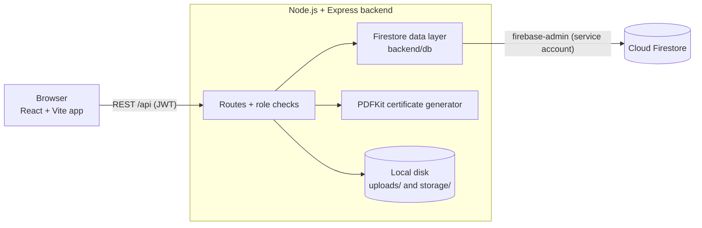

<div align="center">

# 🎓 LearnPool — Smart Learning Management System

**One place where Students learn, Instructors teach and Administrators keep everything running.**


</div>

---

## 📑 Table of contents

1. [Project overview](#1-project-overview)
2. [Features](#2-features)
3. [Technology stack](#3-technology-stack)
4. [Architecture and Firebase usage](#4-architecture-and-firebase-usage)
5. [Folder structure](#5-folder-structure)
6. [Installation and setup](#6-installation-and-setup)
7. [Environment variables](#7-environment-variables)
8. [Database structure](#8-database-structure)
9. [User workflows](#9-user-workflows)
10. [CRUD operations](#10-crud-operations)
11. [Security and permissions](#11-security-and-permissions)
12. [Deployment](#12-deployment)
13. [Troubleshooting](#13-troubleshooting)
14. [Screenshots](#14-screenshots)
15. [Testing and maintenance scripts](#15-testing-and-maintenance-scripts)
16. [Future enhancements](#16-future-enhancements)

---

## 1. Project overview

**LearnPool** is a web-based Learning Management System (LMS) that connects three kinds of people on one platform:

| Role | What they do on LearnPool |
|---|---|
| 🧑‍🎓 **Students** | Browse and join courses, study lessons, take assessments, submit assignments, follow their progress and earn verifiable certificates |
| 👩‍🏫 **Instructors** | Build courses, upload materials, create and grade assignments, watch learner progress and approve certificates |
| 🛡️ **Administrators** | Create accounts, assign roles, manage access, oversee certificates and keep the platform healthy |

### Purpose and objectives

- Give a college or training group **one common sign-in** and a dashboard that automatically matches each person's role.
- Let instructors **create and keep editing** their content (courses, lessons, assessments, assignments) without losing learner data.
- Turn finished courses into **trusted, verifiable certificates** that are only issued after an instructor confirms completion.
- Keep every record in a cloud database (**Cloud Firestore**) so data survives restarts and can be backed up.

### Problems it solves

- Learning material, assignments, grades and certificates are normally scattered across chat apps, e-mail and spreadsheets — LearnPool keeps them in one place.
- Certificates are easy to fake — every LearnPool certificate has a unique ID and a public verification page.
- Role confusion — accounts are created by an administrator and the role always comes from the database, never from what a user types.

---

## 2. Features

> Everything below is implemented in this repository. Items that are only partly available are marked **(partial)**.

### 🔐 Authentication and login

- **One common login page** for every role — no role-selection cards and **no public registration**.
- **Automatic role identification and redirection:** the role (student / instructor / admin) is read from the user's Firestore record after sign-in and decides the dashboard: `/student/dashboard`, `/instructor/dashboard` or `/admin/dashboard`. It is never taken from the e-mail address or the page.
- **First sign-in = onboarding (demo mode only):** any valid e-mail and any password creates a **Student** account (nothing is stored from the typed password) or opens an existing account that has **not yet set a permanent password**. Roles are never granted this way.
- **Set Your Password (Settings):** after onboarding every user creates their own permanent password (new + confirm; there is no "current password" because none exists yet). It is saved in **Firebase Authentication** — or as a bcrypt hash if Firebase Authentication is not configured — and from then on **that password is required, even in demo mode**. Signing out and in again with the same e-mail and password works.
- **Change password:** accounts that already have a permanent password must enter the current one (re-checked with Firebase Authentication) before choosing a new one.
- **Admins control roles:** every new account starts as *Student*. Only an administrator can switch a user to *Instructor* (or back), and the same e-mail and password open the Instructor Dashboard at the next sign-in. Users cannot change their own role.
- **Accounts can also be created by an administrator** (Admin → User management → *Add new user*). The initial password is the part of the e-mail before `@`, and the user must change it at first sign-in.
- **Optional automatic student accounts** for e-mails on domains you list in `AUTO_PROVISION_DOMAINS` (first sign-in with the e-mail username as the password).
- **Any e-mail domain is allowed by default** for students and instructors (configurable with `ALLOWED_EMAIL_DOMAINS`).
- **Forgot / reset password** by e-mail link (needs SMTP settings; skipped silently when SMTP is not configured).
- **Existing accounts keep working:** an older bcrypt password moves into Firebase Authentication automatically the first time its owner signs in with it.

#### Demo / onboarding vs. production authentication

| | **Demo / onboarding** (`DEMO_LOGIN_MODE=true`) | **Production** |
|---|---|---|
| Any e-mail + any password | **New e-mail → Student account.** Existing student / instructor accounts open this way **only until they set a permanent password** | Not available |
| Account that has a permanent password | Password required | Password required |
| Administrator accounts | **Always need their real password** | Real password |
| Creating the first password | *Settings → Set Your Password* (no current password) | Administrator-issued initial password or e-mailed reset link |
| Roles | Student by default; only an admin changes them | Same |
| Availability | **Forced off when `NODE_ENV=production`**, whatever the setting says | — |

> ⚠️ **Demo / onboarding login is for testing only and is not secure authentication.** While it is on, anyone who types an e-mail that has not yet set a permanent password can claim that account by setting the first password. It never grants admin access, it ends for an account as soon as a permanent password exists, and it is disabled in production. Set `DEMO_LOGIN_MODE=false` (or remove it) for real use.

### 🧑‍🎓 Student dashboard

- **Courses:** browse the catalogue, enroll, open enrolled courses and see per-course progress.
- **Lessons and materials:** open uploaded files or external links, mark lessons complete (progress is saved).
- **Assessments:** take timed multiple-choice tests; results are shown after the instructor publishes them.
- **Assignments:** view assignments with due dates and **submit work as a file upload or a link**; see score and feedback once graded.
- **Progress and reports:** course completion, study time, points, a leaderboard and performance charts (**Reports**), plus personal **report notes**.
- **Certificates:** *Request certificate* for completed courses, follow the request status, **view / download** approved certificates under **My Certificates**.
- **Also included:** classroom schedule, files, inbox (messages to other users), notifications, to-do list, per-course discussion forum and an **AI tutor chatbot** (needs `GEMINI_API_KEY`).
- **Profile:** edit full name, phone number and the "About you" bio, set notification preferences, change password, and **upload / preview / replace / remove a profile picture**.

### 👩‍🏫 Instructor dashboard

- **Courses:** create, edit (name, description, subject, level, duration, status, cover image) and delete (archive) your courses.
- **Curriculum:** add and edit **modules, topics and lessons**; upload files (up to 100 MB) or add links; create and edit **assessments and questions**.
- **Assignments:** create, edit, publish/unpublish and delete (blocked once learners have submitted).
- **Evaluation:** review submissions, give **marks and feedback**; learners are notified.
- **Learners:** the *My learners* page lists the learners in your courses; learner progress is also reflected in certificate review.
- **Certificates:** a **Certificate Management** page with a request table, a review window that re-checks real lesson progress, and **Approve / Reject** (rejection requires a reason).
- **Classroom, files, inbox, notifications, to-dos and report notes** as for students.

### 🛡️ Admin dashboard

- **User management:** search and filter users, **add new users**, **change role** (Student ↔ Instructor), **activate / deactivate**, **reset password**, edit details, delete (with confirmation).
- **Platform administration:** enrollments, system settings, announcements, and an **audit log** of important actions.
- **Certificate management:** see every request and every issued certificate, search by student / course / certificate ID, view history, and **revoke** a certificate (reason required).
- Instructor and admin roles can only be assigned by an administrator.

### 📚 Course management

Create, view, edit, update and delete (archive) courses. Editing keeps the same record ID, enrolled learners, lessons, assignments and results. Deleting a course **archives** it (hidden from learners; data is kept). See [CRUD operations](#10-crud-operations).

### 📝 Assignment management

Instructors create assignments with title, instructions, due date, maximum points and a Draft/Published status, and can edit them later. Learners submit once per assignment. Instructors grade with **marks and feedback**.

Safeguards: once any submission is graded the **maximum points are locked**; assignments with submissions **cannot be deleted** (set to Draft instead); changing the due date of a published assignment **notifies enrolled learners**.

### 📊 Reports and progress

- Automatic, read-only figures: course completion, lesson progress, study time, points and performance charts.
- **Editable report notes** (title, summary, period, optional course) — students keep personal notes, instructors/admins can attach notes to a course.

### 🏅 Certificate management

```text
Student finishes every lesson ──► Requests a certificate ──► Request is stored as "Pending"
        ▲                                                           │
        │                                                           ▼
Student views / downloads PDF ◄── PDF + unique ID created ◄── Instructor reviews and verifies completion
        │                          (Approved)                       │ (or rejects with a reason)
        ▼
Anyone can verify the ID at /verify-certificate/LP-2026-001
```

1. A student completes all lessons of a course (**Eligible**).
2. The student clicks **Request certificate** (status **Pending verification**).
3. The course's instructor (or an admin) opens **Certificates → Requests → Review** and sees the student's name, e-mail, course, completion percentage and completion date, plus the lesson-by-lesson record.
4. The instructor **approves** (optional remarks) or **rejects** (reason required). Completion is **re-checked at the moment of approval**.
5. On approval LearnPool creates a sequential ID (`LP-<year>-001`, `LP-<year>-002`, …) and generates a **real PDF** with PDFKit (A4 landscape, green border, LearnPool logo, "CERTIFICATE OF COMPLETION", student, course, instructor, completion and issue dates, certificate ID and verification link).
6. The student finds it under **My Certificates** (course, ID, issue date, **View / Download**); it stays available after signing out and in.
7. Anyone can open **`/verify-certificate/<ID>`** to see validity, ID, student, course, instructor, issue date and status (revoked certificates show **Revoked**; e-mail addresses are never shown).

Statuses: **Not eligible · Eligible · Pending verification · Approved · Rejected · Revoked**.
Duplicates are prevented (one open request and one certificate per learner and course; simultaneous approvals issue only one). Admins can **revoke** with a reason; revoked certificates can no longer be downloaded.

### 👤 Profile management

Full name, phone number, "About you" bio, notification preferences, password change and **profile picture**: choose a JPG, PNG or WebP image (max 2 MB), **preview** it before saving, **replace** or **remove** it. The image file is kept on the backend's disk and its path is saved on the user's Firestore document, so it is still there after signing out and in.

> **Not part of the current UI:** the backend contains Socket.IO live-class chat events and a faculty analytics endpoint, but the present React app has no live-class screen or instructor analytics page (older unused pages exist in `frontend/src/pages`). These are noted as partial.

---

## 3. Technology stack

Only technologies that are actually used are listed.

| Layer | Technology | Version (from `package.json`) |
|---|---|---|
| Frontend framework | **React** (JavaScript / JSX) | 19 |
| Build tool | **Vite** + `@vitejs/plugin-react` | 8 |
| Routing | **React Router** | 7 |
| Styling | Custom stylesheet (`src/styles.css`) with **Tailwind CSS** imported | Tailwind 4 (`@tailwindcss/vite`) |
| UI libraries | `lucide-react` (icons), `react-hot-toast` (toasts), `recharts` (charts in older pages) | 1.x / 2.x / 3.x |
| HTTP / real-time client | `axios`, `socket.io-client` (older live-class page) | 1.x / 4.x |
| Backend runtime | **Node.js** | 20.19+ recommended |
| Backend framework | **Express** | 5 |
| Database | **Cloud Firestore** through **`firebase-admin`** | 13 |
| Authentication | **JWT** sessions (`jsonwebtoken`, 30-day) + passwords in **Firebase Authentication** through `firebase-admin` — or **bcryptjs** hashes when Firebase Authentication is not configured | 9 / 13 / 3 |
| File uploads | `multer` (files kept on the backend's disk) | 2 |
| PDF generation | **PDFKit** | 0.18 |
| E-mail | `nodemailer` (optional SMTP) | 8 |
| AI tutor | `@google/generative-ai` (optional Gemini key) | 0.24 |
| Real-time | `socket.io` (server side, live-class chat events) | 4 |
| Dev tooling | `nodemon`, `eslint` | 3 / 10 |

**Firebase services:** Cloud Firestore (all data) and **Firebase Authentication** (permanent passwords, once you set `FIREBASE_WEB_API_KEY`). **Not used:** Firebase Storage, Firebase Hosting, Cloud Functions, the Realtime Database and the Firebase web SDK — the browser only talks to LearnPool's own API, so there are no `VITE_FIREBASE_*` variables.

---

## 4. Architecture and Firebase usage



| Piece | How it works |
|---|---|
| **Firebase project** | You create a Firebase project and enable **Cloud Firestore** (Native mode). |
| **Credentials** | The backend authenticates to Firestore with a **service-account key** (`backend/serviceAccountKey.json`, or `FIREBASE_SERVICE_ACCOUNT_JSON`, or three `FIREBASE_*` variables). The key never reaches the browser. |
| **Data layer** | `backend/db/` is a small Mongoose-style layer (schemas, `find`, `populate`, `save`, …) on top of Firestore, so the routes read like ordinary model code. See [Database structure](#8-database-structure). |
| **Security rules** | `firestore.rules` denies **all** direct client access. This is safe because only the backend (Admin SDK, which bypasses rules) talks to Firestore. |
| **Authentication** | LearnPool JWT sessions. Passwords are **set** with the Admin SDK and **checked** by Firebase Authentication's own sign-in (using `FIREBASE_WEB_API_KEY`); the Firebase user id equals the Firestore user document id. Without a web API key LearnPool falls back to bcrypt hashes in Firestore. Roles always come from Firestore. |
| **File storage** | Local disk on the backend server: `backend/uploads/` (avatars, lessons, submissions, files) and `backend/storage/certificates/` (certificate PDFs). Firebase Storage is **not** used. |
| **Hosting** | Not configured (there is no `firebase.json`). See [Deployment](#12-deployment). |

Request flow: the React app calls the Express API with `Authorization: Bearer <token>` → middleware (`protect`, role checks) → route handler → Firestore. Every sensitive rule (roles, ownership, certificate approval) is enforced **on the backend**.

---

## 5. Folder structure

```text
LearnPool-MERN/
├── README.md                    ← this file
├── firestore.rules              ← deny-all rules for direct client access
├── .gitignore
├── backend/                     ← Express API + Firestore data layer
│   ├── server.js                ← app entry: CORS, routes, uploads, Socket.IO, Firestore connect
│   ├── package.json
│   ├── .env.example             ← backend settings template
│   ├── db/                      ← Firestore data layer (Mongoose-style API)
│   │   ├── index.js             ← models, queries, populate, locks, connection
│   │   ├── firestoreStore.js    ← the only file that talks to firebase-admin
│   │   ├── schema.js · match.js · util.js
│   ├── models/                  ← schemas: User, Course, Module, Lecture, Topic, Test,
│   │                              Result, Progress, Discussion, LiveSession, LmsItem
│   ├── routes/                  ← REST API
│   │   ├── auth.js              ← login, change/reset password, /me, demo config
│   │   ├── users.js             ← user management, profile, profile picture
│   │   ├── courses.js · modules.js · tests.js · progress.js
│   │   ├── workspace.js         ← assignments, submissions, files, classes, messages,
│   │   │                          notifications, to-dos, announcements, reports, settings
│   │   ├── certificates.js      ← requests, approval, PDF, verification, revocation
│   │   ├── analytics.js · tracking.js · discussions.js · ai.js
│   ├── middleware/auth.js       ← JWT check, role guard, first-login password block
│   ├── utils/                   ← accounts, demo, audit, courseProgress,
│   │                              certificatePdf, sendEmail, emailTemplate
│   ├── scripts/                 ← createAdmin.js, backupFirestore.js, migrateFromMongo.js
│   └── test/                    ← smoke.js (offline data-layer test) + memoryStore.js
├── frontend/                    ← React app (the maintained UI)
│   ├── index.html · vite.config.js · eslint.config.js · package.json
│   ├── .env.example             ← VITE_API_URL
│   └── src/
│       ├── main.jsx             ← entry
│       ├── App.jsx              ← routes, dashboards, courses, assignments, reports, …
│       ├── api.js               ← axios client, role → dashboard helper
│       ├── styles.css           ← LearnPool green-and-white theme
│       ├── components/
│       │   ├── AccountPages.jsx     ← login, change password, user management, profile picture
│       │   ├── CertificatePages.jsx ← certificates (student/instructor/admin) + public verify page
│       │   ├── EditTools.jsx        ← edit/create forms, confirm dialog, assessment editor, report notes
│       │   ├── DiscussionForum.jsx · AIChatbot.jsx
│       ├── pages/ · contexts/ · components/Navbar.jsx · components/analytics/
│       │                        ← older screens not used by the current app (kept for reference)
├── client/                      ← an older standalone React app, not maintained
├── package-lock.json · patch-final.mjs · snippet.cjs   ← leftover helper files from earlier development
```

Generated at run time and ignored by Git: `node_modules/`, `backend/.env`, `backend/serviceAccountKey.json`, `backend/uploads/`, `backend/storage/`, `backend/backups/`, `frontend/dist/`.

---

## 6. Installation and setup

### Prerequisites

| Tool | Notes |
|---|---|
| **Node.js** | 20.19 or newer (22 LTS recommended) — includes npm |
| **npm** | Comes with Node.js |
| **Git** | To clone and push the project |
| **Firebase account** | Free (Spark) plan is enough for development |
| **Code editor** | For example VS Code |

### 1) Clone the project

```bash
git clone https://github.com/<your-username>/<your-repository>.git
cd <your-repository>
```

### 2) Install dependencies

```bash
cd backend
npm install
cd ../frontend
npm install
```

### 3) Create the Firebase project and database

1. Open the [Firebase console](https://console.firebase.google.com/) and **create a project** (Analytics is optional).
2. In the sidebar open **Firestore Database** (under *Databases and storage* / *Build*) → **Create database**.
   - Choose **Standard edition**, database ID **`(default)`**, **Native mode**, and a location near you (it cannot be changed later).
   - **Production mode** is fine — the backend uses admin access and `firestore.rules` denies direct client access.
3. Open **Project settings → Service accounts → Generate new private key** and save the downloaded file as **`backend/serviceAccountKey.json`**. This file is a secret — never commit or share it (it is already in `.gitignore`).

> You do **not** need to register a web app or enable Storage or Hosting — LearnPool does not use them.

#### Turn on Firebase Authentication (recommended)

This is what stores permanent passwords. Without it LearnPool still works, but passwords are kept as bcrypt hashes in Firestore.

1. In the Firebase console open **Authentication → Get started → Sign-in method** and enable **Email/Password**.
2. Open **Project settings → General** and copy the **Web API Key**. Put it in `backend/.env` as `FIREBASE_WEB_API_KEY=...` (see [Environment variables](#7-environment-variables)).
3. Recommended: in **Authentication → Settings → User actions** turn **off** "Enable create (sign-up)" so nobody can register Firebase accounts directly — LearnPool creates them itself on the backend.
4. Recommended: in Google Cloud **APIs & Services → Credentials**, restrict that API key to the *Identity Toolkit API*.
5. Restart the backend. `GET http://localhost:5000/api/auth/config` should now show `"authProvider":"firebase"`.

### 4) Configure the environment

```bash
# from the project root
cd backend
cp .env.example .env          # Windows PowerShell: copy .env.example .env
```

Open `backend/.env` and at least set a long random **`JWT_SECRET`** (32+ characters). See [Environment variables](#7-environment-variables).

Optional: `cp frontend/.env.example frontend/.env` if your API is not at `http://localhost:5000/api`.

### 5) Apply the Firestore security rules (recommended)

Open **Firestore Database → Rules** in the console and paste the contents of [`firestore.rules`](firestore.rules), then **Publish**. (They deny all direct client access; the backend is unaffected.) See also [Deployment](#12-deployment) for the CLI route.

### 6) Create the first administrator

```bash
cd backend
# macOS / Linux
ADMIN_NAME="Admin" ADMIN_EMAIL="you@example.com" ADMIN_PASSWORD="a-long-password-12+" npm run create-admin
```

```powershell
# Windows PowerShell
$env:ADMIN_NAME="Admin"; $env:ADMIN_EMAIL="you@example.com"; $env:ADMIN_PASSWORD="a-long-password-12+"
npm run create-admin
```

The password must be at least 12 characters. Administrators can use any e-mail address.

### 7) Run the application

Use **two terminals**:

```bash
# Terminal 1 — backend (http://localhost:5000)
cd backend
npm run dev            # nodemon, restarts on code changes
# or:  npm start       # plain node
```

Wait for `Firestore connected`.

```bash
# Terminal 2 — frontend (http://localhost:5173)
cd frontend
npm run dev
```

Open **http://localhost:5173**. The frontend requires port **5173** (`strictPort`); stop any other process using it.

> Changes to `backend/.env` are **not** picked up automatically — type `rs` in the nodemon window (or stop and restart) after editing it.

### 8) Build the frontend for production

```bash
cd frontend
npm run build          # outputs frontend/dist
npm run preview        # optional: serve the production build locally
npm run lint           # optional: ESLint
```

### All verified commands

| Where | Command | What it does |
|---|---|---|
| `backend` | `npm run dev` | Start the API with auto-restart (nodemon) |
| `backend` | `npm start` | Start the API with plain Node |
| `backend` | `npm test` | Offline tests: the Firestore data layer and the credential layer, including a fake Firebase Authentication (no Firebase project needed) |
| `backend` | `npm run create-admin` | Create an administrator (needs `ADMIN_*` variables) |
| `backend` | `npm run backup` | Save every collection to `backend/backups/*.json` |
| `backend` | `npm run migrate:mongo` | One-time copy from an old MongoDB database (needs `npm install --no-save mongodb`) |
| `frontend` | `npm run dev` | Start the Vite dev server |
| `frontend` | `npm run build` | Production build → `frontend/dist` |
| `frontend` | `npm run preview` | Serve the production build |
| `frontend` | `npm run lint` | Run ESLint |

---

## 7. Environment variables

### Backend — `backend/.env`

Copy from [`backend/.env.example`](backend/.env.example). Never commit the real `.env`.

| Variable | Required | Purpose |
|---|---|---|
| `PORT` | no (5000) | API port |
| `JWT_SECRET` | **yes** | Secret used to sign login tokens — use 32+ random characters |
| `AUTH_PROVIDER` | no (`auto`) | Where passwords live: `firebase`, `local` (bcrypt hash in Firestore) or `auto` (Firebase once `FIREBASE_WEB_API_KEY` is set) |
| `FIREBASE_WEB_API_KEY` | for Firebase Authentication | Firebase console → Project settings → General → Web API Key. Lets the backend check passwords with Firebase |
| `FIREBASE_AUTH_EMULATOR_HOST` | no | Use the local Firebase Auth emulator, e.g. `127.0.0.1:9099` |
| `CLIENT_ORIGIN` | yes for non-local use | Allowed browser origin(s) for CORS (comma-separated). Default `http://localhost:5173` |
| `PUBLIC_APP_URL` | recommended | Public address of the frontend; used in certificate verification links |
| `FIREBASE_SERVICE_ACCOUNT_PATH` | one of 3 ways | Path to the service-account JSON (default `backend/serviceAccountKey.json`) |
| `FIREBASE_SERVICE_ACCOUNT_JSON` | one of 3 ways | The key JSON (or its base64) — handy on hosting providers |
| `FIREBASE_PROJECT_ID`, `FIREBASE_CLIENT_EMAIL`, `FIREBASE_PRIVATE_KEY` | one of 3 ways | The three values from the key file |
| `FIRESTORE_EMULATOR_HOST` | no | Use the local Firestore emulator, e.g. `127.0.0.1:8080` |
| `ALLOWED_EMAIL_DOMAINS` | no (`*`) | Which e-mails may be students/instructors: `*` or e.g. `@college.edu,@gmail.com` |
| `AUTO_PROVISION_DOMAINS` | no (empty = off) | Domains whose first sign-in (password = e-mail username) may create a Student account, e.g. `@yourcollege.edu` |
| `AUTO_PROVISION_STUDENTS` | no (`true`) | Set `false` to switch automatic student accounts off even when domains are listed |
| `DEMO_LOGIN_MODE` | no (off) | `true` = onboarding access: any e-mail + any password opens a new student, or an account with no permanent password yet (testing only; **ignored when `NODE_ENV=production`**) |
| `DEMO_ALLOW_INSTRUCTORS` | no (on while demo mode is on) | Instructors can use onboarding access (any password) until they set a permanent password. Set `false` to require a real password from instructors |
| `DEMO_ALLOW_PRIVILEGED_ACCOUNTS` | no (off) | Would also open admin accounts — **keep `false`** |
| `EMAIL_HOST`, `EMAIL_PORT`, `EMAIL_USER`, `EMAIL_PASS`, `EMAIL_FROM` | optional | SMTP for password-reset and notification e-mails (`SMTP_*`, `FROM_*` names also work) |
| `GEMINI_API_KEY` | optional | Enables the AI tutor chatbot |
| `NODE_ENV` | no | Set `production` when deployed (also disables demo login) |
| `ADMIN_NAME`, `ADMIN_EMAIL`, `ADMIN_PASSWORD` | only for `create-admin` | Used once to create the first administrator |
| `MONGO_URI` | only for `migrate:mongo` | Old MongoDB database to copy from |

> The service-account key, `JWT_SECRET`, SMTP passwords and `GEMINI_API_KEY` are **secrets**. Keep them out of Git.

### Frontend — `frontend/.env` (optional)

```env
VITE_API_URL=http://localhost:5000/api
```

This is the only frontend variable. It is read **at build time**, so set it before `npm run build` when the API is on another address.

---

## 8. Database structure

LearnPool uses **Cloud Firestore**. Each model is one top-level collection; documents use 24-character hexadecimal IDs and references are stored as ID strings. Dates are Firestore timestamps.

### Collections

| Collection | Important fields |
|---|---|
| **`users`** | `name`, `email` (unique, lower-case), `credentialProvider` (`firebase` / `local`), `passwordSetupComplete`, `password` (bcrypt hash — **only** in local mode; absent when Firebase Authentication holds the password), `role` (`student` / `instructor` / `faculty` / `admin`), `status` (`active` / `suspended` / `disabled`), `isApproved`, `isVerified`, `mustChangePassword`, `isDemo`, `teacherCode`, `profilePicture` (path), `phoneNumber`, `bio`, `skills[]`, `interests[]`, `enrolledCourses[]`, `points`, `studySeconds`, `preferences`, `lastActive`, `passwordChangedAt` · hidden fields: `otpCode`, `otpExpiry`, `passwordResetToken`, `passwordResetExpiry` |
| **`courses`** | `title`, `description`, `category`, `level` (`Beginner`/`Intermediate`/`Advanced`), `status` (`draft`/`published`/`archived`), `thumbnail`, `duration`, `faculty` → users, `modules[]`, `students[]`, `updatedBy`, timestamps |
| **`modules`** | `title`, `course` → courses, `lectures[]`, `topics[]`, `tests[]`, `liveSessions[]`, `updatedBy` |
| **`topics`** | `title`, `description`, `module`, `lectures[]`, `tests[]`, `updatedBy` |
| **`lectures`** (lessons) | `title`, `fileUrl`, `fileType` (`external/link` for links), `module`, `updatedBy` |
| **`tests`** (assessments) | `title`, `duration`, `negativeMarking`, `shuffleQuestions`, `isAdaptive`, `resultsPublished`, `module`, `questions[]` (`questionText`, `options[]`, `correctAnswerIndex`, `marks`, `difficulty`, `timeLimit`), `updatedBy` |
| **`results`** | `student`, `test`, `score`, `total`, `percentage`, `answers[]`, `attemptNumber`, `malpracticeLogs[]`, `violationCount` |
| **`progresses`** | `user`, `lecture`, `completed` — one row per learner and lesson |
| **`discussions`** | `course`, `author`, `text`, `likes[]`, `replies[]` (`author`, `text`, `likes[]`) |
| **`livesessions`** | `topic`, `roomId`, `isActive`, `module` |
| **`lmsitems`** | A flexible record used for most workspace content: `type`, `owner`, `course`, `recipients[]`, `data` (type-specific), `readAt`, `updatedBy`, timestamps |
| `_locks` | Short-lived marker documents that prevent duplicate work (automatic; expire on their own) |

### `lmsitems` record types

| `type` | Stored in `data` (main fields) |
|---|---|
| `assignments` | `title`, `description`, `dueDate`, `maxGrade`, `status` (`draft`/`published`), `course`, `courseName` |
| `submissions` | `assignmentId`, `assignmentTitle`, `courseName`, `maxGrade`, `fileName`/`storedName` or `submissionUrl`, `notes`, `submittedAt`, `status` (`submitted`/`graded`), `grade`, `feedback`, `gradedAt` |
| `classes` | `title`, `startTime`, `endTime`, `meetingLink`, `recordingUrl`, `description`, `courseName` |
| `files` | `name`, `storedName`, `mimeType`, `size`, `category`, `description` |
| `messages` | `subject`, `content`, `senderName`, `recipientName`, `recipientEmail` (`recipients[]` holds the receiver) |
| `notifications` | `type`, `title`, `message`, `entityId` (`readAt` on the record) |
| `todos` | `title`, `description`, `dueDate`, `priority`, `completed` |
| `announcements` | `title`, `body`, `audience` (`all`/`student`/`instructor`) |
| `reports` | `title`, `description`, `periodStart`, `periodEnd`, `courseName` (report notes) |
| `sessions` | `startedAt`, `lastHeartbeatAt`, `activeSeconds`, `status` (study-time tracking) |
| `system-settings` | `settingKey`, `settingValue`, `description` |
| `audit-logs` | `action` plus the ID of what changed |
| `certificate-requests` | `studentId`, `studentName`, `studentEmail`, `courseId`, `courseTitle`, `instructorId`, `instructorName`, `completionPercentage`, `completedAt`, `requestedAt`, `status` (`pending`/`approved`/`rejected`), `remarks`, `rejectionReason`, `reviewedBy`, `reviewedByName`, `reviewedAt`, `certificateId`, `certificateRecordId`, `history[]` |
| `certificates` | `certificateNumber` (`LP-<year>-NNN`), `recipientName`, `courseName`, `courseId`, `instructorId`, `instructorName`, `completionPercentage`, `completedAt`, `issuedAt`, `status` (`issued`/`revoked`), `verificationEnabled`, `approvedByName`, `requestId`, `pdfFile`, `revokedAt`, `revocationReason`, `history[]` |

### Relationships

```text
users ─┬─ teaches ─► courses ─► modules ─┬─► lectures ◄── progresses (per learner)
       │                                  ├─► topics ─► lectures
       │                                  └─► tests ◄── results (per learner)
       ├─ enrolled in ─► courses.students[]
       ├─ owns ─► lmsitems (assignments, submissions, files, messages, reports …)
       └─ requests ─► certificate-requests ─► (approval) ─► certificates ─► PDF in backend/storage/certificates
```

Roles: `student`, `instructor` (stored as `instructor`; older `faculty` is treated the same) and `admin`. The role always comes from the user's document.

---

## 9. User workflows

### Student

```text
Sign in ─► Student dashboard (/student/dashboard) ─► Browse courses & enroll ─► Complete lessons
 ─► Submit assignments ─► Track progress (Reports) ─► Request certificate (Certificates)
 ─► Instructor approval ─► My Certificates: View / Download PDF
```

First sign-in with an initial password asks for a new password before anything else.

### Instructor

```text
Sign in ─► Instructor dashboard (/instructor/dashboard) ─► Create courses ─► Add modules, lessons, materials
 ─► Create assignments & assessments ─► Review submissions (marks + feedback) ─► Watch learners' progress
 ─► Certificates ─► Review request ─► Approve (PDF is generated) or Reject with a reason
```

### Administrator

```text
Sign in ─► Admin dashboard (/admin/dashboard) ─► User management ─► Add users / assign Student or Instructor roles
 ─► Activate · deactivate · reset passwords ─► Enrollments, announcements, system settings, audit log
 ─► Certificates ─► search requests and certificates, view history, revoke if necessary
```

---

## 10. CRUD operations

All changes are saved to Cloud Firestore through the backend API (`PUT`/`PATCH` update the **same record** — no duplicates). Every request is checked for the user's role and ownership on the server, and edits record `updatedAt` / `updatedBy`.

| Module | Create | Read | Update | Delete |
|---|---|---|---|---|
| **Courses** | Instructor / Admin | Everyone enrolled; catalogue for students | Course's instructor, admin (`PUT /api/courses/:id`) | Archives the course (instructor / admin) |
| **Modules, topics** | Course's instructor | Enrolled learners | `PUT /api/modules/:id`, `/api/modules/topics/:id` | Instructor / admin |
| **Lessons / learning materials** | Upload (≤ 100 MB) or link | Enrolled learners | Title, link or replacement file (`PUT /api/modules/lectures/:id`) | Instructor / admin |
| **Assessments & questions** | Instructor | Learners (answers hidden) | `PUT /api/tests/:id` (only rewording once attempted) | Instructor / admin (results kept) |
| **Assignments** | Instructor / admin | Enrolled learners (published only) | `PATCH /api/workspace/assignments/:id` | Blocked if submissions exist |
| **Submissions** | Learner (file ≤ 20 MB or link, once) | Owner and the course's instructor | Instructor grades (marks + feedback) | — |
| **Classes, announcements, files, to-dos** | Per role | Per role | `PATCH /api/workspace/<type>/:id` | Owner / admin |
| **Reports (notes)** | Any user (students: personal only) | Owner; instructor reports visible to enrolled students | Author / admin | Author / admin |
| **Users** | Admin (`POST /api/users`) | Admin | Role, status, details, password reset (admin); profile (self) | Admin |
| **Certificates** | Automatic after instructor approval | Owner, course's instructor, admin; public verification | Approve / reject requests; admin revokes | Not deletable (revoke instead) |

---

## 11. Security and permissions

### ✅ Implemented

- **Passwords:** stored and verified by **Firebase Authentication** when configured (no password or hash in Firestore), otherwise as bcrypt hashes; plain text is never stored and nothing password-related goes into `localStorage`. First-login password change is enforced by the backend.
- **Sessions:** signed JWT (30-day), sent as a Bearer token; account status (`active`) is re-checked on each request.
- **Role-based access control** on the backend (`protect` + role checks) — hiding a button is never the only protection. Students cannot use instructor/admin APIs; instructors cannot use admin APIs; users cannot change their own role.
- **Certificate approval authorization:** only the course's own instructor or an admin can approve/reject; students can never approve; completion is re-verified on approval; only admins can revoke.
- **Login throttling:** repeated wrong passwords from the same IP and e-mail are slowed down.
- **Demo / onboarding limits:** off by default, forced off in production, never opens admin accounts, creates students only, stops working for an account the moment it has a permanent password, and its tokens are rejected from then on.
- **Roles:** read from Firestore on every request (no role is trusted from the browser); only an administrator can change a role.
- **Firestore rules:** `firestore.rules` denies all direct client reads/writes; the backend alone accesses data with a service account.
- **File upload restrictions:**
  - Profile pictures: JPG / PNG / WebP only, **max 2 MB**, file type checked by content.
  - Workspace files and submissions: allowed extensions only (`pdf, doc(x), ppt(x), xls(x), txt, png, jpg, jpeg, mp4, zip`), **max 20 MB**.
  - Lesson materials: allowed extensions only, **max 100 MB**.
- **Private files:** library, lesson and submission files are not served publicly (they go through signed-in routes); certificate PDFs live in `backend/storage/` and are served only to their owner, the course's instructor and admins.
- **Public verification** exposes only certificate ID, student name, course, instructor, dates and status — no e-mail addresses.
- **Audit log** of important admin and certificate actions; **locks** prevent duplicate accounts, requests and certificates.
- **CORS** restricted to `CLIENT_ORIGIN`.

### 💡 Recommended improvements (not implemented)

- Store the login token in an `httpOnly` cookie instead of `localStorage`, and add security headers (`helmet`) and global rate limiting.
- Move uploaded files and certificate PDFs to object storage (for example Firebase Storage / Google Cloud Storage) for multi-server deployments.
- Add e-mail verification and multi-factor authentication for instructor/admin accounts.
- Scan uploads for malware and add automated API tests to CI.
- Uniqueness rules (such as one account per e-mail) are checked before saving and protected by locks for the critical paths; heavy concurrent writes elsewhere are not fully atomic.

---

## 12. Deployment

LearnPool has **two parts** that are deployed separately: the **React build** (static files) and the **Express backend** (a long-running Node.js server). **Firebase Hosting is not configured in this repository** (there is no `firebase.json`), and Firebase Hosting alone cannot run the Express backend — so pick a Node host for the backend.

### Backend (Node.js host)

1. Provide the environment variables from [section 7](#7-environment-variables) on your host — especially `NODE_ENV=production`, a strong `JWT_SECRET`, `FIREBASE_WEB_API_KEY`, `CLIENT_ORIGIN` (your frontend address), `PUBLIC_APP_URL`, and the Firebase credentials via `FIREBASE_SERVICE_ACCOUNT_JSON` (or the three `FIREBASE_*` variables).
2. Make sure `DEMO_LOGIN_MODE` is **not** `true` (it is ignored in production anyway).
3. Run `npm install` then `npm start` in `backend/`.
4. Give the server a **persistent disk** for `backend/uploads/` and `backend/storage/` — uploaded files and certificate PDFs are stored there (see *Recommended improvements*).

### Frontend (static hosting)

```bash
cd frontend
# make sure VITE_API_URL points to your deployed API, then:
npm run build
```

Upload the contents of `frontend/dist/` to any static host. Because the app uses client-side routes, configure the host to serve `index.html` for unknown paths.

### Optional: Firebase Hosting and Firestore rules (not preconfigured)

If you want to use Firebase for hosting the built frontend and for deploying `firestore.rules`, add the configuration yourself first:

```bash
npm install -g firebase-tools
firebase login
firebase init            # choose Hosting and Firestore; Hosting public directory: frontend/dist
                         # configure as a single-page app (rewrite all URLs to /index.html)
                         # Firestore rules file: firestore.rules
cd frontend && npm run build && cd ..
firebase deploy                         # hosting + rules
firebase deploy --only firestore:rules  # rules only
```

`firebase init` creates `firebase.json` and `.firebaserc`, which this project does not yet include. Storage rules and Cloud Functions do not apply because those services are not used.

---

## 13. Troubleshooting

| Problem | Cause and fix |
|---|---|
| `npm install` fails or shows engine warnings | Use Node.js 20.19+ (`node -v`). Delete `node_modules` and `package-lock.json` only as a last resort, then reinstall. Run `npm install` in **both** `backend` and `frontend`. |
| `Firestore connection error: 5 NOT_FOUND` | The Firestore **database was never created** in that Firebase project (or the key belongs to a different project). Create it: Firestore Database → *Create database* → Native mode, ID `(default)`. |
| Backend says the Firebase key is missing / `PERMISSION_DENIED` | Put the key at `backend/serviceAccountKey.json` (or set `FIREBASE_SERVICE_ACCOUNT_JSON`). Re-download it if it was revoked. |
| API returns **503 "Database is not connected"** | The backend started but could not reach Firestore. Check the terminal for the connection error and your internet connection. |
| Terminal never prints `Firestore connected` | Wrong credentials or no database yet (see above). Check `JWT_SECRET` is also set. |
| Settings shows **Set Your Password** instead of *Change password* | You are in an onboarding session (no permanent password yet). Create one there; afterwards sign in with it. |
| "Firebase Authentication is not turned on for this project" | Console → Authentication → Get started → Sign-in method → enable **Email/Password**, then try again. |
| "FIREBASE_WEB_API_KEY is not set" / "not valid for this Firebase project" | Copy the Web API Key from Project settings → General into `backend/.env` (or set `AUTH_PROVIDER=local`) and restart the backend. |
| "could not reach Firebase Authentication" | Check your internet connection; the backend calls Google's servers to check passwords. |
| An instructor cannot sign in after being promoted | They sign in with the same e-mail and password. If they never set a permanent password, demo mode lets any password in; otherwise ask an admin to use *User Management → Reset password*. |
| Login says "Incorrect email or password" | Normal when the account does not exist or the password is wrong. For testing set `DEMO_LOGIN_MODE=true`, then type `rs` in the nodemon window. Open `http://localhost:5000/api/auth/config` — it must show `"demoMode":true`. |
| Demo mode stays `false` | `.env` edits need a restart (`rs`); the line must be exactly `DEMO_LOGIN_MODE=true`; and `NODE_ENV` must not be `production`. |
| "Please change your initial password" | Expected for admin-created accounts — sign in and choose a new password. |
| Browser shows a **CORS error** | Set `CLIENT_ORIGIN` in `backend/.env` to the exact frontend address and restart the backend. |
| Frontend cannot reach the API | Make sure the backend is running on port 5000, or set `VITE_API_URL` (and rebuild for production). |
| `Port 5173 is already in use` | Vite is set to `strictPort`. Stop the other process using 5173. |
| `EADDRINUSE :::5000` | An old backend is still running — stop it (`Ctrl + C`) or change `PORT`. |
| Firestore quota / `RESOURCE_EXHAUSTED` | The free plan has daily read/write limits. Wait for the reset or upgrade the plan. |
| Upload errors (`413`, "file type not supported") | Respect the limits in [section 11](#11-security-and-permissions) (profile 2 MB, files 20 MB, lessons 100 MB, allowed extensions only). |
| Uploaded files vanish after redeploy | Uploads are on the backend's local disk; use a persistent disk or move to object storage. |
| Certificate PDF cannot be created/downloaded | Check the backend can write to `backend/storage/certificates/`; run `npm install` so `pdfkit` is present; revoked certificates intentionally return an error. If a PDF file is deleted it is rebuilt from the saved record on the next download. |
| Certificate verification link points to `localhost` | Set `PUBLIC_APP_URL` to your real frontend address. |
| Password-reset e-mail never arrives | SMTP is optional; without `EMAIL_*` settings e-mails are skipped. Add SMTP credentials to `.env`. |
| AI tutor says to add a key | Set `GEMINI_API_KEY` in `backend/.env`. |
| `rs` is "not recognized" | `rs` works only inside the nodemon window, not in a normal PowerShell prompt. |
| Deployment shows a blank page on refresh | Configure the static host to rewrite unknown paths to `index.html`. |

---

## 14. Screenshots

No screenshots are committed to this repository yet. To add them, save images (for example in a `docs/screenshots/` folder) and reference them here with relative paths such as ``. Useful pages to capture: login, student / instructor / admin dashboards, courses, assignments, certificate management, *My Certificates* and the profile page.

---

## 15. Testing and maintenance scripts

```bash
cd backend
npm test            # offline tests: data layer + credential layer (in-memory fakes, incl. Firebase Authentication)
npm run backup      # JSON backup of all collections → backend/backups/
```

`npm test` verifies the data layer (queries, populate, saves, unique rules, atomic increments) and the credential layer (setting and verifying passwords in Firebase mode and local mode, moving old hashes into Firebase, e-mail changes, error messages) without needing a Firebase project. The fake Firebase Authentication is a test double, so a real Firebase check still needs your own project. It does not exercise the HTTP routes; there is no automated frontend test suite.

---

## 16. Future enhancements

These are **ideas, not implemented features**:

- Sign in with Google and multi-factor authentication through Firebase Authentication, plus e-mail verification for new accounts.
- Move file storage to Firebase Storage / Google Cloud Storage and serve certificate PDFs from it.
- Firebase Hosting + Cloud Run / Cloud Functions configuration for one-command deployment.
- A live-class video screen (the backend already has chat events) and an instructor analytics dashboard.
- Automated route and end-to-end tests with a CI pipeline.
- QR code on the certificate PDF and shareable certificate links.
- Grade-book export (CSV / PDF), course reviews and in-app announcements for course groups.
- Dark mode, multi-language support and an installable mobile app (PWA).

---

<div align="center">

Built with ❤️ for learners and instructors — **LearnPool**

*Add a `LICENSE` file before publishing the repository publicly.*

</div>
